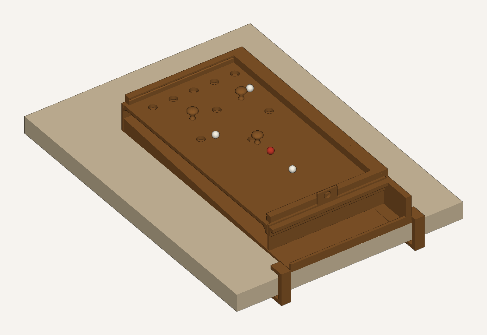
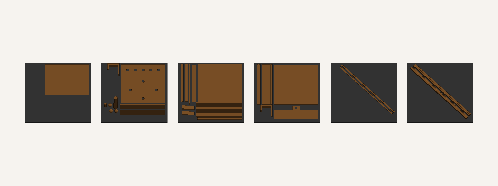
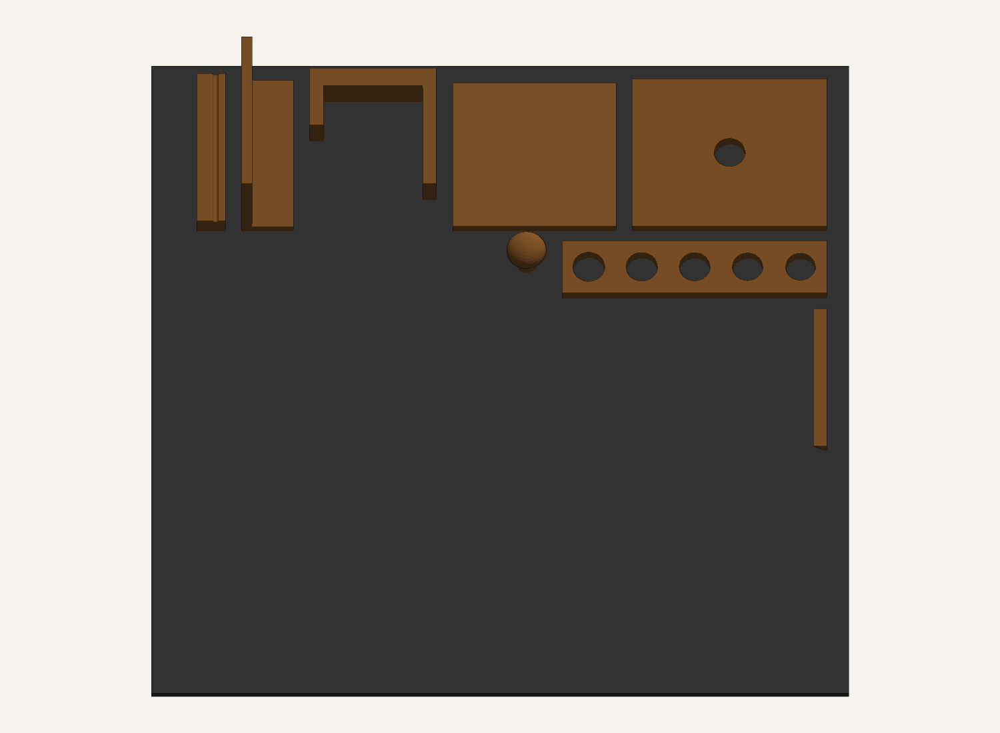
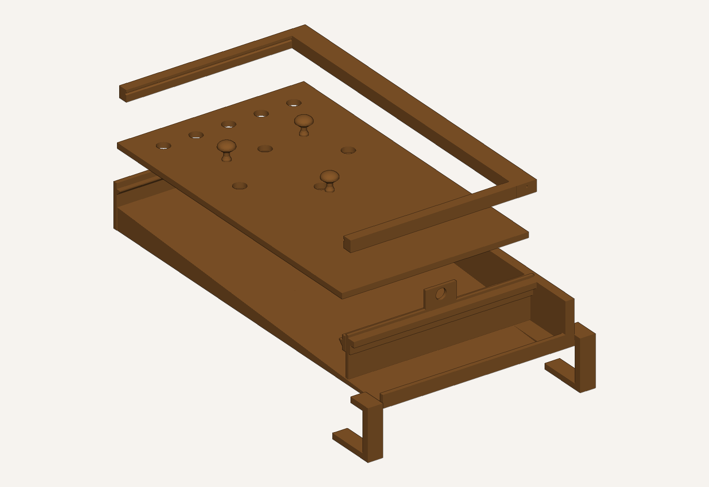
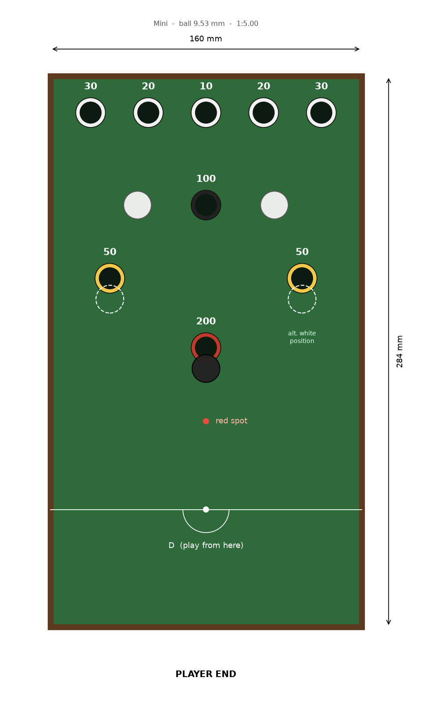

# Desk Bar Billiards — 3D-printable plans

A scale bar billiards table — the pub game with nine holes in the bed,
mushroom skittles and a ball return to the player's end — sized to sit on,
and clamp to, a desk. Everything is generated by a short Python script, so
it resizes to the balls you can buy and the printer you actually own.



**Start here:** print the fit-test coupon (one plate, about an hour), check
it, then print the Mini table.

```bash
python barbilliards.py --coupon --out stl_coupon
```

---

## 1. Pick a size

Three presets, all one colour by default. `--size` chooses between them.

| | Mini (default) | Standard | Large |
|---|---|---|---|
| Ball | 9.5 mm (⅜″) | 12.7 mm (½″) | 15.9 mm (⅝″) |
| Scale | 1:5 | 1:3.75 | 1:3 |
| Playing area | 160 × 284 mm | 213 × 379 mm | 267 × 474 mm |
| On the desk | 211 × 354 × 51 mm | 268 × 460 × 63 mm | 325 × 569 × 78 mm |
| Printed pieces | 29 (25 files) | 33 (29 files) | 47 (43 files) |
| Filament (est.) | ~710 g | ~1.2 kg | ~2.0 kg |
| Plates on a P1S | ≤ 6 | ≤ 7 | ≤ 19 |

Figures are for a Bambu Lab P1S in PLA, `--variant simple`.
`python barbilliards.py --fit` prints the same table for your printer.

The playing surface is **level**, as on a real table. The slope is
underneath: balls that drop through any hole land on a 3° ramp and roll back
to an open tray at the player's end. A removable **time-bar gate** drops in
front of the tray to stop them returning, exactly like the bar that falls
inside a pub table when the money runs out.

---

## 2. Things to buy

Quantities below are for the Mini; the others only change the sizes.

| Item | Qty | Notes |
|---|---|---|
| 9.5 mm (⅜″) balls | 7 white + 1 red | Acetal/Delrin or nylon precision balls roll nicely and are light enough not to batter the skittles. Chrome steel works too — paint one red. Glass marbles are too irregular. |
| Self-adhesive billiard felt / baize | 1 sheet ≥ 175 × 295 mm | An A4 sheet covers the Mini, A3 the Standard. Any thin, firm felt; avoid fluffy craft felt. |
| 2 mm silicone or rubber cord (O-ring cord) | ~1 m | The cushions. 3 mm for the Standard, 4 mm for the Large. |
| 8 mm hardwood dowel | 1 × 300 mm | The cue shaft. |
| 9 mm leather or rubber cue tip | 1 (optional) | Glue onto the printed ferrule; the plain printed tip works too. |
| Glue | | CA (superglue) for small parts, 2-part epoxy for the frame. |
| Rubber bumpers | 4 (optional) | Under the walls if you'd rather not clamp it. |

Measure your desk top before printing: `--desk 25` (mm) sizes the clamps.

---

## 3. Print it

Python 3.10+ with numpy; matplotlib as well if you want the previews:

```bash
python -m venv .venv
.venv/Scripts/python -m pip install -r requirements.txt
```

Run the generator, then read `stl/print_plan.md` — it lists walls, infill,
plate and filament for every file, for the printer and filament you chose.
`stl/parts.csv` is the same thing as a spreadsheet.

```bash
python barbilliards.py --coupon --out stl_coupon   # 1 plate, ~1 h  <- first
python barbilliards.py                             # the table -> stl/
```



**On a Bambu Lab P1S** (the default) that is PLA, 0.2 mm layers, and the
textured PEI plate it came with — no plate swap and no AMS. Every STL is
already rotated so a large flat face is on the plate, so **turn off
auto-orient**; some long strips only fit turned 45°, which the slicer's
arrange handles. Nothing needs supports: if your slicer wants to add them,
something has been re-oriented.

Other machines are one flag away:

```bash
python barbilliards.py --printer a1mini      # smaller bed -> more pieces
python barbilliards.py --printer mk4 --material petg
python barbilliards.py --list                # every printer, filament, size
```

### The fit-test coupon



Eight small parts, about 60 g, that exercise every fit in the table:

| File | What it tells you |
|---|---|
| `test_hole_gauge` | Five holes, −0.4 to +0.4 mm. Drop a ball through each: the one that swallows it cleanly without rattling is the size your printer wants. |
| `test_playfield_corner` | Slab thickness, flatness, and the hole with felt over it. |
| `test_wall` + `test_ledge` | Glue them together: the slab corner should land flush with the wall top. |
| `test_rail` | Press the cord in — the nose should touch a ball at about ⅔ of a ball height above the felt. |
| `test_ramp` | A ball should roll down it, not stall on a layer line. |
| `test_skittle` | Must stand up, and topple when a ball brushes it. |
| `test_clamp` | Hook it over the test wall's flange and onto your desk. |

If the gauge says you want a different hole size, regenerate with a tweaked
`--ball` (or adjust the `1.20 * ball` factor in `table.py`) before committing
to the full print.

---

## 4. Assembly



Dry-fit everything before gluing. Epoxy for the frame, CA for small parts.
Part names below are the STL filenames.

1. **Side walls.** Glue the halves of each side wall end to end on a flat
   surface (`_1` is the front). Use a straight edge to keep them true.
2. **Ledge strips.** Glue each ledge strip to the inside face of its wall so
   its flat top is level with the playfield's underside. Leave a gap at each
   end for the front beam and back wall, which carry their own ledges.
3. **Ramps.** Lay the wedges on the desk between where the walls will go:
   thin end at the front, thick end at the back. Glue them to each other,
   not to the walls yet.
4. **Box.** Stand the walls either side of the ramps and glue in, between
   them: the **back wall** (ledge inward), the **front beam** (ledge towards
   the far end), the **apron beam** just in front of it — that gap is the
   gate slot, so use the gate plus a sheet of paper as a spacer — and the
   **tray lip** at the very front. Check the diagonals match.
5. **Playfield.** Glue the tiles into one sheet on a flat surface, face
   down, with the **splice plates** epoxied across every seam underneath.
   Let it cure flat, then drop it into the box — it sits on the ledges all
   round — and glue it down.
6. **Felt.** Print `previews/felt_template_A4.pdf` at **100 % / actual
   size** (check the 50 mm bar), tape the pages together on the crosses, and
   use it to cut the felt and mark the hole centres and spots. Stick the
   felt down, smoothing from the centre out, then cut the holes with a sharp
   knife.
7. **Rails.** Glue the four rails on top of the walls and playfield edge,
   groove facing inward. The side rails run the full length; the far and
   front rails fit between them. Stagger the side-rail seams away from the
   wall seams.
8. **Cushions.** Cut cord to length and glue it into the rail grooves with
   CA, a few centimetres at a time. Mitre the ends at 45° in the corners.
9. **Cue.** Glue the printed tip ferrule and butt onto the dowel.
   Optionally glue on a leather tip and sand it to a dome.
10. **Mount.** Put the table at the front edge of the desk, tray lip flush
    with the edge, hook a clamp over each side flange and tap a shim in
    between the clamp's lower jaw and the underside of the desk. Or skip the
    clamps and use rubber bumpers.


---

## 5. Layout and setting up



- Back row: **30 · 20 · 10 · 20 · 30**. Diamond: **100** (far), **50**s
  (sides), **200** (nearest you).
- **Black skittle** directly in front of the 200.
- **White skittles** either side of the 100 (league layout); many pubs put
  them in front of the 50s instead (dashed on the plan).
- Play every shot from the **D**. White ball on the D spot, red on the red
  spot to start.

With `--variant simple` the skittles are all one colour — mark the black one
with a pen, and write the scores on the felt beside each hole.

## 6. Rules in brief

- Pot balls in holes for the points shown; the **red scores double**.
- Your break continues while you pot something each shot. Missing ends it.
- Knock over a **white skittle**: you lose that break's score.
  Knock over the **black**: you lose your **whole score**.
- Not hitting a ball at all, or a ball coming back behind the baulk line, is
  a foul.
- **Timing:** pub tables run ~15–17 minutes. Set a phone timer; when it
  goes, drop the **gate** in. Balls now stop under the table, so the game
  winds down. The last ball may only be potted into the 100 or 200, off a
  side cushion.

Full rules: All England Bar Billiards Association / Masters Traditional
Games rule sheets.

---

## 7. Customising

Everything is generated by Python 3 with numpy (and matplotlib for the
previews only):

```bash
python barbilliards.py --size standard       # the nicest one to play on
python barbilliards.py --variant full        # coloured hole rings, every clamp size, two cues
python barbilliards.py --ball 11 --cord 2.5  # the balls you actually found
python barbilliards.py --slope 4             # steeper ball return
python barbilliards.py --felt 0              # no felt: bare printed surface
python check.py                              # design rules, after any change
python render.py                             # previews, plan and felt template
```

`--variant full` is the pub-table look: white rings on the 10/20/30, yellow
on the 50s, black on the 100, red on the 200, a red gate, a black skittle
and two white ones. It needs six filament colours, which is why `simple` is
the default.

Hole and skittle positions live at the top of `table.py` in **real-table
millimetres**, so you can match a particular pub's table and everything
below re-derives.

**Accuracy note.** The outline follows league dimensions (~800 × 1420 mm
playing area, 47.6 mm balls). Exact hole and spot positions vary between
makers (Sams, Jelkes, Burroughs & Watts…) and aren't published precisely, so
the ones here are a faithful *approximation* of a standard English table
rather than a copy of one.

## 8. Ideas

- Replace the manual gate with a micro servo and an ESP32 that drops it
  after 15 minutes. A coin slot is optional.
- A small scoreboard with sliding pointers.
- A ribbed ramp: the solid wedges are the biggest print on the plate.

---

Working on the code? `AGENTS.md` has the design rules and the house style.
