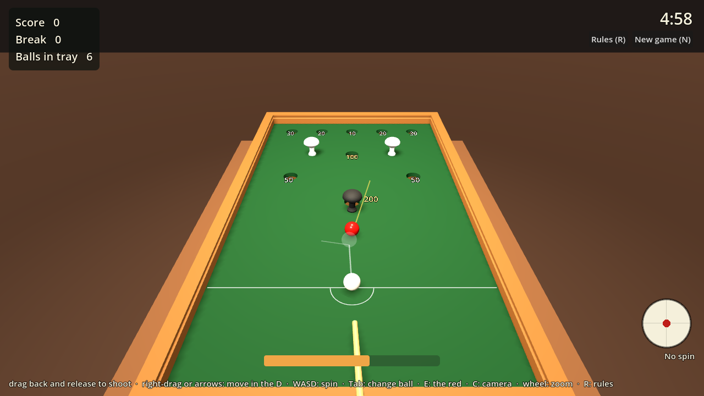
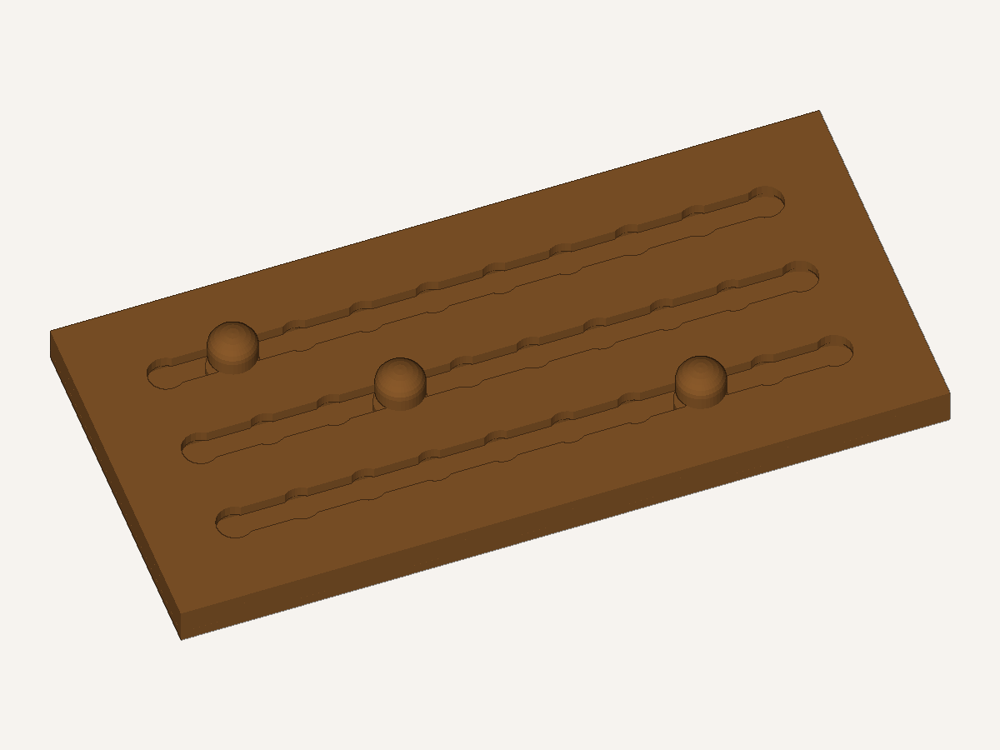
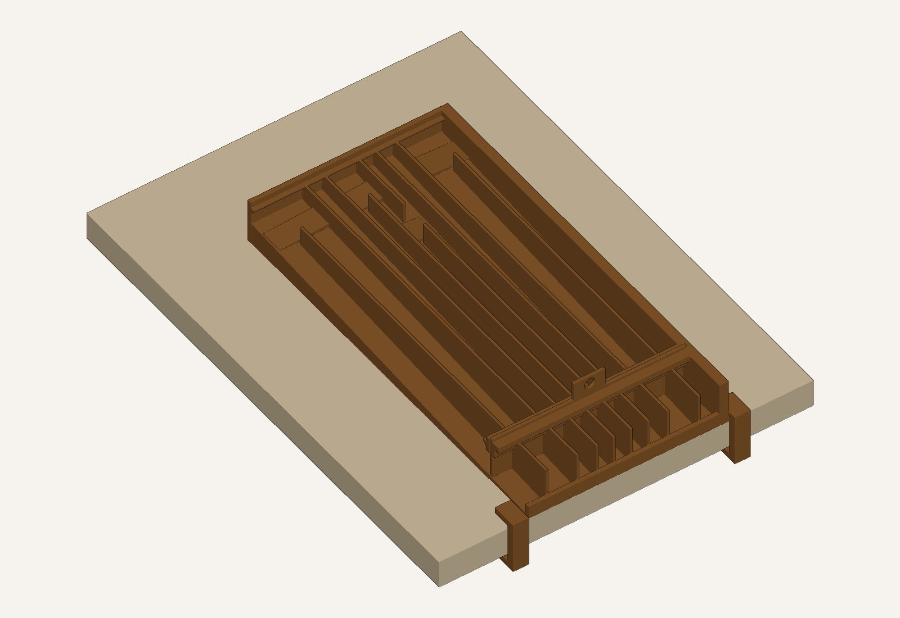
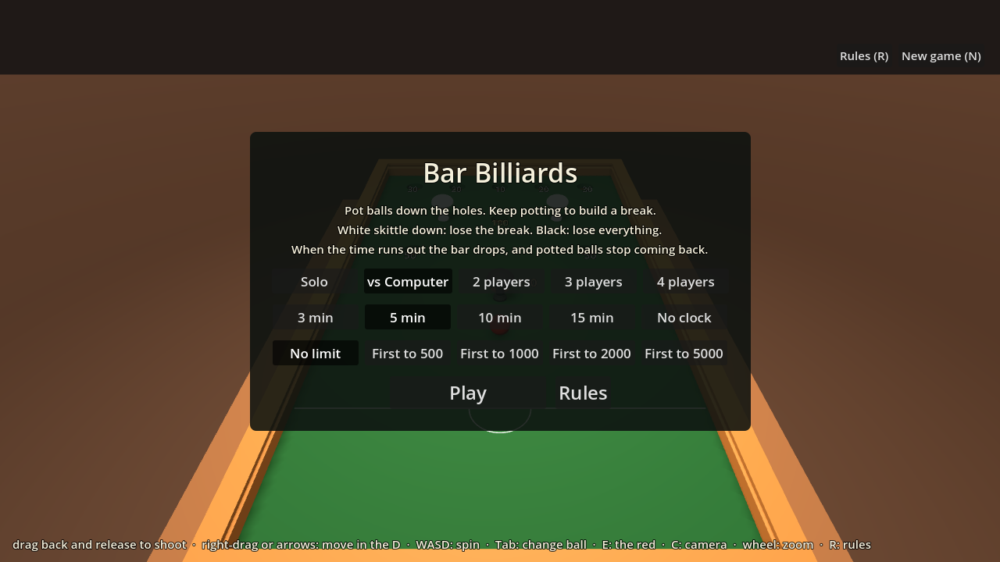
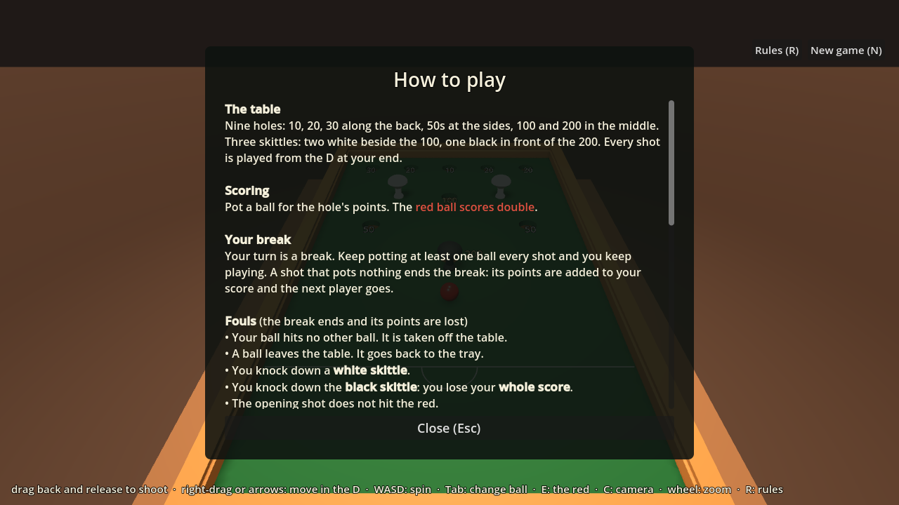
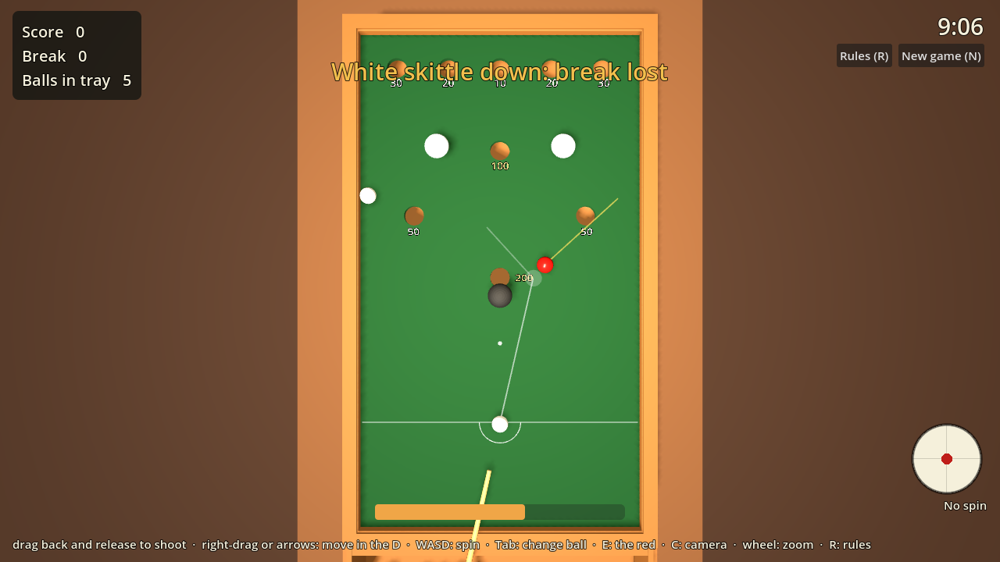
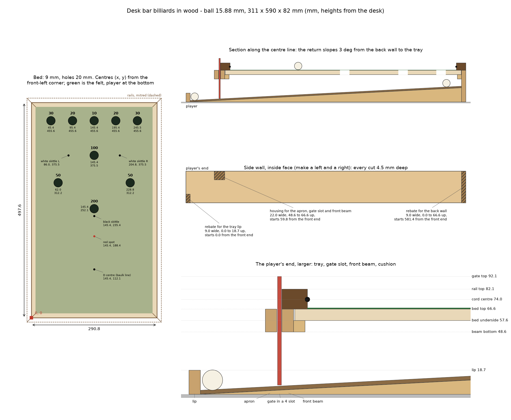

# Desk Bar Billiards — 3D-printable plans

A scale bar billiards table — the pub game with nine holes in the bed,
mushroom skittles and a ball return to the player's end — sized to sit on,
and clamp to, a desk. Everything is generated by a short Python script, so
it resizes to the balls you can buy and the printer you actually own.


The same model is also a game you can play in a browser — see
[§9](#9-play-it-on-screen):



No printer, or want something bigger? The same table can be built in wood
— see [§10](#10-build-it-in-wood).

**Start here:** print the fit-test coupon (one plate, about an hour), check
it, then print the Mini table.

```bash
python barbilliards.py --coupon --out stl_coupon
```

---

## 1. Pick a size

Three presets, all one colour by default. `--size` chooses between them.

| | Mini (default) | Standard | Large |
|---|---|---|---|
| Ball | 9.5 mm (⅜″) | 12.7 mm (½″) | 15.9 mm (⅝″) |
| Scale | 1:5 | 1:3.75 | 1:3 |
| Playing area | 160 × 284 mm | 213 × 379 mm | 267 × 474 mm |
| On the desk | 211 × 354 × 51 mm | 268 × 460 × 63 mm | 325 × 569 × 78 mm |
| Printed pieces | 35 (29 files) | 39 (33 files) | 53 (47 files) |
| Filament (est.) | ~740 g | ~1.2 kg | ~2.0 kg |
| Plates on a P1S | ≤ 6 | ≤ 7 | ≤ 19 |

Figures are for a Bambu Lab P1S in PLA, `--variant simple`.
`python barbilliards.py --fit` prints the same table for your printer.

The playing surface is **level**, as on a real table. The slope is
underneath: balls that drop through any hole land on a 3° ramp and roll back
to an open tray at the player's end. A removable **time-bar gate** drops in
front of the tray to stop them returning, exactly like the bar that falls
inside a pub table when the money runs out.

A **slider scoreboard** prints alongside it — three rows of 0-9 for
hundreds, tens and units, with captive markers you push along with a
fingertip. It is the same size whatever table you build.



---

## 2. Things to buy

Quantities below are for the Mini; the others only change the sizes.

| Item | Qty | Notes |
|---|---|---|
| 9.5 mm (⅜″) balls | 7 white + 1 red | Acetal/Delrin or nylon precision balls roll nicely and are light enough not to batter the skittles. Chrome steel works too — paint one red. Glass marbles are too irregular. |
| Self-adhesive billiard felt / baize | 1 sheet ≥ 175 × 295 mm | An A4 sheet covers the Mini, A3 the Standard. Any thin, firm felt; avoid fluffy craft felt. |
| 2 mm silicone or rubber cord (O-ring cord) | ~1 m | The cushions. 3 mm for the Standard, 4 mm for the Large. |
| 8 mm hardwood dowel | 1 × 300 mm | The cue shaft. |
| 9 mm leather or rubber cue tip | 1 (optional) | Glue onto the printed ferrule; the plain printed tip works too. |
| Glue | | CA (superglue) for small parts, 2-part epoxy for the frame. |
| Rubber bumpers | 4 (optional) | Under the walls if you'd rather not clamp it. |

Measure your desk top before printing: `--desk 25` (mm) sizes the clamps.

---

## 3. Set up and print

Python 3.10 or newer, and Docker if you want the game. Nothing else gets
installed on the machine: Godot runs in a container, and there is no CAD
package and no Blender step.

```bash
git clone git@github.com:AidanJones/pocket_bar_billiards.git
cd pocket_bar_billiards
python -m venv .venv
```

Then activate it — on Windows `.venv/Scripts/activate`, on macOS and
Linux `source .venv/bin/activate` — and:

```bash
pip install -r requirements.txt
python check.py          # should end "0 failure(s)"
```

Every command below assumes that venv is active. `numpy` is all the
generator and the checks need; `matplotlib` is only for `render.py`.

Run the generator, then read `stl/print_plan.md` — it lists walls, infill,
plate and filament for every file, for the printer and filament you chose.
`stl/parts.csv` is the same thing as a spreadsheet.

```bash
python barbilliards.py --coupon --out stl_coupon   # 1 plate, ~1 h  <- first
python barbilliards.py                             # the table -> stl/
```


**On a Bambu Lab P1S** (the default) that is PLA, 0.2 mm layers, and the
textured PEI plate it came with — no plate swap and no AMS. Every STL is
already rotated so a large flat face is on the plate, so **turn off
auto-orient**; some long strips only fit turned 45°, which the slicer's
arrange handles. Nothing needs supports: if your slicer wants to add them,
something has been re-oriented.

Other machines are one flag away:

```bash
python barbilliards.py --printer a1mini      # smaller bed -> more pieces
python barbilliards.py --printer mk4 --material petg
python barbilliards.py --list                # every printer, filament, size
```

### The fit-test coupon


Eight small parts, about 60 g, that exercise every fit in the table:

| File | What it tells you |
|---|---|
| `test_hole_gauge` | Five holes, −0.4 to +0.4 mm. Drop a ball through each: the one that swallows it cleanly without rattling is the size your printer wants. |
| `test_playfield_corner` | Slab thickness, flatness, and the hole with felt over it. |
| `test_wall` + `test_ledge` | Glue them together: the slab corner should land flush with the wall top. |
| `test_rail` | Press the cord in — the nose should touch a ball at about ⅔ of a ball height above the felt. |
| `test_ramp` | A ball should roll down it, not stall on a layer line. |
| `test_skittle` | Must stand up, and topple when a ball brushes it. |
| `test_clamp` | Hook it over the test wall's flange and onto your desk. |

If the gauge says you want a different hole size, regenerate with a tweaked
`--ball` (or adjust the `1.20 * ball` factor in `table.py`) before committing
to the full print.

---

## 4. Assembly


Dry-fit everything before gluing. Epoxy for the frame, CA for small parts.
Part names below are the STL filenames.

1. **Side walls.** Glue the halves of each side wall end to end on a flat
   surface (`_1` is the front). Use a straight edge to keep them true.
2. **Ledge strips.** Glue each ledge strip to the inside face of its wall so
   its flat top is level with the playfield's underside. Leave a gap at each
   end for the front beam and back wall, which carry their own ledges.
3. **Ramps.** Lay the wedges on the desk between where the walls will go:
   thin end at the front, thick end at the back. Glue them to each other,
   not to the walls yet.
4. **Box.** Stand the walls either side of the ramps and glue in, between
   them: the **back wall** (ledge inward), the **front beam** (ledge towards
   the far end), the **apron beam** just in front of it — that gap is the
   gate slot, so use the gate plus a sheet of paper as a spacer — and the
   **tray lip** at the very front. Check the diagonals match.
5. **Playfield.** Glue the tiles into one sheet on a flat surface, face
   down, with the **splice plates** epoxied across every seam underneath.
   Let it cure flat, then drop it into the box — it sits on the ledges all
   round — and glue it down.
6. **Felt.** Print `previews/felt_template_A4.pdf` at **100 % / actual
   size** (check the 50 mm bar), tape the pages together on the crosses, and
   use it to cut the felt and mark the hole centres and spots. Stick the
   felt down, smoothing from the centre out, then cut the holes with a sharp
   knife.
7. **Rails.** Glue the four rails on top of the walls and playfield edge,
   groove facing inward. The side rails run the full length; the far and
   front rails fit between them. Stagger the side-rail seams away from the
   wall seams.
8. **Cushions.** Cut cord to length and glue it into the rail grooves with
   CA, a few centimetres at a time. Mitre the ends at 45° in the corners.
9. **Cue.** Glue the printed tip ferrule and butt onto the dowel.
   Optionally glue on a leather tip and sand it to a dome.
10. **Scoreboard.** Lay `score_back` flat, put `score_track` on it and drop
    a `score_marker` into each channel, foot down. Glue `score_face` on top
    with all three edges flush — the markers are now captive. Keep glue out
    of the channels. If a marker is stiff, pull it out before the glue sets
    and sand the shaft; if it is sloppy, a smear of petroleum jelly in the
    channel gives it some drag. Cut the two strips from the scoreboard page
    of the template PDF and glue them along the bottom and left edges. Print
    a second set for your opponent.
11. **Mount.** Put the table at the front edge of the desk, tray lip flush
    with the edge, hook a clamp over each side flange and tap a shim in
    between the clamp's lower jaw and the underside of the desk. Or skip the
    clamps and use rubber bumpers.


---

## 5. Layout and setting up


- Back row: **30 · 20 · 10 · 20 · 30**. Diamond: **100** (far), **50**s
  (sides), **200** (nearest you).
- **Black skittle** directly in front of the 200.
- **White skittles** either side of the 100 (league layout); many pubs put
  them in front of the 50s instead (dashed on the plan).
- Play every shot from the **D**. White ball on the D spot, red on the red
  spot to start.

With `--variant simple` the skittles are all one colour — mark the black one
with a pen, and write the scores on the felt beside each hole.

Keep score on the printed scoreboard: one board each, markers at 0-0-0 to
start. Bar billiards is scored by hand — the table itself does not tell you
what you potted.

## 6. Scored ball return (optional)

```bash
python barbilliards.py --return sorted
```

By default every potted ball rolls back to one shared tray, which is what a
real bar billiards table does — the score is kept by hand, on the
scoreboard. `--return sorted` instead divides the space under the bed into
**nine lanes, one per hole**, so a returned ball is sitting in a compartment
that tells you what it scored.



Five of the holes drop straight into their own lane. Four need help: the
10, the 100 and both 30s land on a small **chute** glued to the ramp under
the hole, which rolls the ball sideways into its lane. The 10 and 100 need
it because they share the centreline with the 200; the 30s because they sit
only 10 mm from the 50s, which is closer than a hole is wide, so there is
nowhere to put a wall between them.

The layout is solved from the hole positions, so it still works if you edit
them — and `layout.json` lists each lane's score and X range. Mark the tray
lip with a pen so you can read it at a glance.

It costs about 20 extra pieces and one more plate. In the physics
simulation (section 9) **all nine balls reach the right lane**, as do all
nine with the shared return — but neither has been printed yet, and a
simulation is not a plate. If you are printing your first table, print the
shared return: it is 20 pieces simpler and it is what a real table does.

## 7. Rules in brief

- Pot balls in holes for the points shown; the **red scores double**.
- Your break continues while you pot something each shot. Missing ends it.
- Knock over a **white skittle**: you lose that break's score.
  Knock over the **black**: you lose your **whole score**.
- Not hitting a ball at all, or knocking a ball off the table, is a foul:
  the break ends and its points are lost. A ball left behind the baulk line
  goes back to the tray.
- The first shot of the game, and the first after the table is cleared
  (red back on its spot), must hit the red.
- **Timing:** pub tables run ~15–17 minutes. Set a phone timer; when it
  goes, drop the **gate** in. Balls now stop under the table, so the game
  winds down. The last ball may only be potted into the 100 or 200, off a
  side cushion.

Full rules: All England Bar Billiards Association / Masters Traditional
Games rule sheets.

---

## 8. Customising

Everything is generated by Python 3 with numpy (and matplotlib for the
previews only):

```bash
python barbilliards.py --size standard       # the nicest one to play on
python barbilliards.py --variant full        # coloured hole rings, every clamp size, two cues
python barbilliards.py --ball 11 --cord 2.5  # the balls you actually found
python barbilliards.py --slope 4             # steeper ball return
python barbilliards.py --felt 0              # no felt: bare printed surface
python check.py                              # design rules, after any change
python render.py                             # previews, plan and felt template
```

`--variant full` is the pub-table look: white rings on the 10/20/30, yellow
on the 50s, black on the 100, red on the 200, a red gate, a black skittle
and two white ones. It needs six filament colours, which is why `simple` is
the default.

Hole and skittle positions live at the top of `table.py` in **real-table
millimetres**, so you can match a particular pub's table and everything
below re-derives.

**Accuracy note.** The outline follows league dimensions (~800 × 1420 mm
playing area, 47.6 mm balls). Exact hole and spot positions vary between
makers (Sams, Jelkes, Burroughs & Watts…) and aren't published precisely, so
the ones here are a faithful *approximation* of a standard English table
rather than a copy of one.

## 9. Play it on screen

The same model drives a Godot game, playable in a browser — and in VR when
you plug a headset in. The table, holes, ramp and return are the generated
geometry, life size: a potted ball really drops through the hole, rolls down
the ramp and arrives back in the tray before you can play it again.

```bash
python gltf.py                              # table.glb for the game
python godot/tools/web_export.py --serve    # http://localhost:8070
```

| | | |
|---|---|---|
|  |  |  |

**Playing.** Press, pull back and let go — the further you pull from where
you pressed, the harder the shot (the bar goes green → amber → red). A click
on its own does nothing; easing back, or a right-click, calls a shot off. While you aim, a ghost
ball shows where it will make contact, and lines show where the ball it hits
will go and where yours will glance off. Right-drag or the arrow keys move
your ball within the D, **Tab** swaps it for another from the tray, **E**
(or the red button, shown when the red is in the tray) plays the red,
**W A S D** or the ball face in the corner put spin on (top follows
through, back draws, side changes the angle off a cushion), **C**
switches to the overhead camera, the wheel zooms, **R** shows the rules and
**N** starts a new game. Each hole's value is marked beside it.

Play solo, against the computer, or two to four players; with a 3–15
minute clock or none, after which the bar drops and the game runs down;
and with a score limit (first to 500 … 5000) or none. It plays the rules
in §7, including the last-ball rule once the bar is down. Every rule has a
test, both on its own and played out on the table through the physics:

```bash
python godot/tools/game_test.py
```

It is also how the ball return gets tested without printing anything:

```bash
python godot/tools/physics_test.py --return sorted
```

drops a ball through all nine holes and tells you which lane each one ended
up in. Needs Docker; `godot/README.md` has the detail.

## 10. Build it in wood

`woodwork.py` turns the same model into woodworking plans: a cut list, a
marking-out table for the holes, a dimensioned plan and section, and step
by step instructions.

```bash
python woodwork.py                          # Large (default) -> wood/, previews/wood_plan.png
python woodwork.py --size standard          # any size, or --ball / --cord of your own
python woodwork.py --ball 47.6 --cord 10    # a full-size league table, 926 x 1741 mm
```



Everything the ball touches or needs room for — playing area, hole
positions and size, cushion height, the headroom under the bed, the 3°
return, the tray and the gate's gaps — comes from the same model as the
printed table, so the two play the same. What changes is the
construction:

- **Stock you can buy.** The bed, frame and ramp are standard sheet
  thicknesses (birch ply or MDF, hardboard for the ramp), picked by ball
  size. The rails are ripped from hardwood, with the cord in a groove.
- **Holes from real bits.** The smallest Forstner bit or hole saw that
  clears the ball by 1.5 mm: 12 mm for the Mini, 16 for the Standard,
  20 for the Large, a 60 mm hole saw at league size.
- **A sloped board, not wedges.** A hardboard ramp on tapered bearers.
- **Proper joints.** The back wall and tray lip sit in rebates in the side
  walls, the apron and front beam share a housing with a filler strip
  between them that sets the gate slot exactly, and the rails meet in
  mitres. The frame squares itself and the glue is on long grain.
  `--joints butt` gives plain glued butt joints instead, if all you have is
  a saw.
- **Printed small parts.** Print the skittles, the cue tip and butt and the
  scoreboard (`python barbilliards.py`), or turn the skittles — the guide
  gives their sizes.

| | Mini | Standard | Large (default) | League (`--ball 47.6`) |
|---|---|---|---|---|
| On the desk | 188 × 362 mm | 252 × 481 mm | 311 × 590 mm | 926 × 1741 mm |
| Bed | 6 mm | 6 mm | 9 mm | 18 mm |
| Holes | 12 mm | 16 mm | 20 mm | 60 mm hole saw |

The build guide for the default size is [`wood/wood_plan.md`](wood/wood_plan.md),
with the cut list in `wood/cut_list.csv`. The 1:1 felt template
(`previews/felt_template_A4.pdf`) doubles as a drilling template; the
guide says where to line it up. `check.py` applies the wooden build's own
rules too, for both joint styles (headroom, bit size, gate gaps, rail lap,
sheet size, and housings that leave enough wall between them).

## 11. Ideas

- Replace the manual gate with a micro servo and an ESP32 that drops it
  after 15 minutes. A coin slot is optional.
- A small scoreboard with sliding pointers.
- A ribbed ramp: the solid wedges are the biggest print on the plate.

---

Working on the code? `AGENTS.md` has the design rules and the house
style, and `TODO.md` has what is and is not finished — including the fact
that **none of this has been printed yet**.
