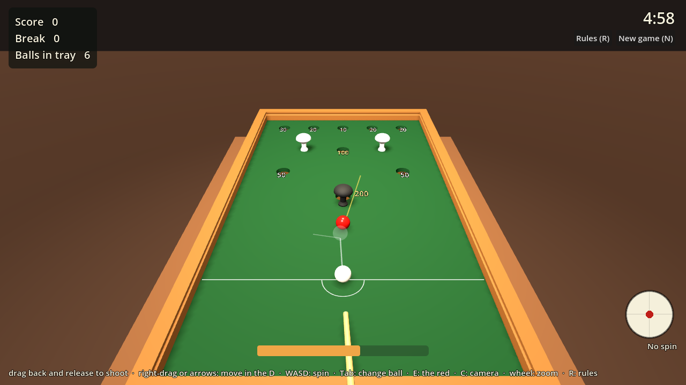
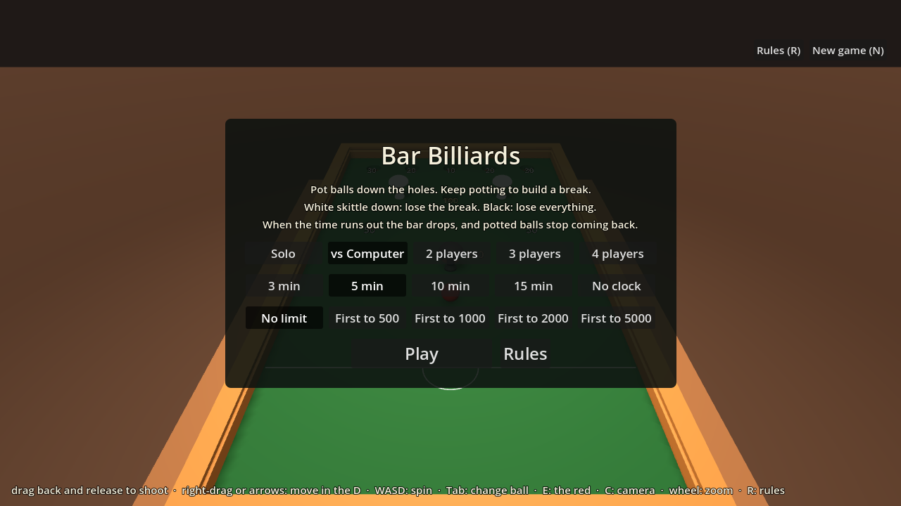
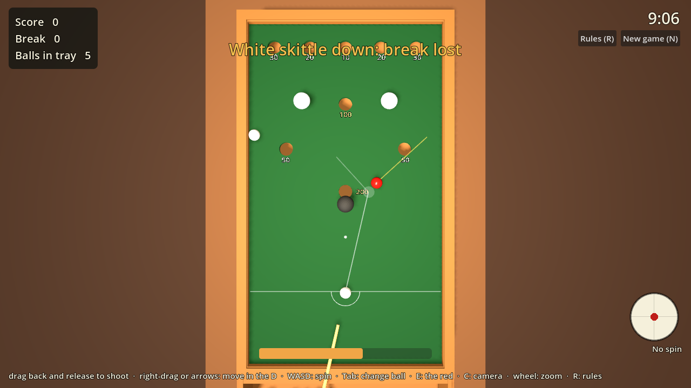

# The game

A Godot 4.3 version of the same table, playable in a browser and (with a
headset plugged in) in VR — and, more usefully while the design is still
moving, a physics rig for testing the ball return before anything is
printed.



## One model, two outputs

```
          table.py  (the model: parameters -> geometry)
            /                                  \
   barbilliards.py                           gltf.py
     stl/*.stl                        godot/assets/table.glb
   the printed table                  godot/assets/table_layout.json
```

There is no second model and no Blender step. `table.py` is the source of
truth; `barbilliards.py` slices it into printable pieces, and `gltf.py`
writes the *assembled* thing as one `.glb` plus the JSON the game needs for
hole positions, spots and lane extents. Change the table in Python and both
outputs follow.

Blender is not in the loop because nothing needs it: the geometry is
generated, the parts are flat-coloured, and at ~8,700 triangles the whole
table is far below anything a browser or a headset would struggle with. If
you later want baked lighting or textured materials, that is the point at
which a Blender pass earns its place — the `.glb` imports straight into it.

**The game runs life size.** The exporter shows a real league table
(47.6 mm ball, 800 × 1420 mm bed) rather than the desk-sized print, because
Godot's solver is happiest around human scale and because in VR you want to
stand at a real table.

It is the printed table **blown up uniformly** — not the generator re-run
with a bigger ball. That distinction matters: wall thickness, clearances and
splice plates are set by the nozzle, not by the ball, so re-generating at
47.6 mm leaves a 48 mm ball rattling around inside 4 mm walls, and it goes
straight through them. Scaling the whole thing by 3.75 keeps the
proportions a real table has. `--as-printed` leaves it at 1:1 with the
STLs.

Units on the way out: millimetres and Z-up become **metres and Y-up**, the
player stands at **+Z**, and the table is lifted so its bed sits 0.75 m off
the floor.

## Running it

Everything goes through Docker, so there is no native Godot install to
manage. Start Docker Desktop first.

```bash
python gltf.py                                  # regenerate assets/
python godot/tools/physics_test.py              # drop a ball through every hole
python godot/tools/physics_test.py --return sorted
python godot/tools/web_export.py --serve        # browser build on :8070
python godot/e2e/web_smoke.py                   # load that build in Chromium, play a shot
python godot/tools/screenshots.py               # refresh screenshots/
cd godot && docker compose --profile vnc up godot-vnc   # watch/play on :6080
```

The compose volumes carry `:z`, so this works on SELinux hosts (Fedora,
RHEL) as well as Docker Desktop, and the containers run as your user so
`.godot/` and `web_export/` are not left owned by root.

Headless checks on the game itself, after `--` on the Godot command line
(`docker compose run --rm godot --headless --quit-after 400000 -- ...`):

| Flag | Does |
|---|---|
| `--smoke` | the ball-return test below |
| `--autoplay --shots N [--minutes M]` | plays N random shots and fails if a ball is ever lost; a short `--minutes` runs it to the bar dropping and game over |
| `--start [--players 2]` | skip the menu |
| `--screenshot PATH [--aim] [--camera 1]` | save a frame (needs a display: see `tools/screenshots.py`) |

### Playing

The rules are in `scripts/rules.gd`, kept apart from the physics; the main
README §7 has them in brief. Each shot is played with a ball from the tray,
placed in the D, and the shot is over when everything on the felt has
stopped — balls already rolling home under the bed are not waited for, so
the next shot is ready while they are still coming back. If the tray is
empty the game waits for one to arrive; with the bar down, it never does,
and that is the end of the game.

| | |
|---|---|
|  |  |

The aim guide sweeps a ball-sized sphere along the shot (`cast_motion`) and
reads the contact normal where it first touches (`get_rest_info`). Off a
ball, the object ball is drawn leaving along the line of centres and yours
along the tangent — the 90° rule, exact for a ball with no spin, which is
the only kind this game plays. Off a cushion it draws the rebound.

Before writing it we looked for an open-source Godot pool game to borrow
from. The closest was [Shadowfetch Pool](https://github.com/ShadowfetchStudio/shadowfetch-pool)
(MIT, Godot 4.7, Jolt): its ball is the same damped `RigidBody3D` this one
uses, and its guide is a fixed-length straight line, so there was nothing
to lift. [BreakoutShot](https://github.com/danielKlmr/BreakoutShot) (MIT) is
2D. Its ideas worth taking later are side spin (a torque impulse at the
strike) and aiming with the mouse while setting power separately.

### The physics test

This is the part that earns its keep. `check.py` can prove a return lane is
wide enough and that no lane wall sits under a hole; it cannot prove that a
ball dropped through the 100 ends up in the 100's lane rather than bouncing
into the 200's. So `scripts/smoke_test.gd` drops a ball through each of the
nine holes in turn, lets it run, and reports where it came to rest:

```
[smoke] hole  returned  lane     resting place (m)
[smoke] 30    yes       30       (-0.287, +0.713, +0.612)
...
```

It exits non-zero if a ball never reaches the tray, or — with
`--return sorted` — lands in the wrong lane. The table's holes, ramp and
lane walls are all real collision geometry taken from the model, so the ball
falls through and rolls home because the shape says so, not because anything
fakes it.

### What it has found so far

**Shared return: 9 of 9.** Every hole returns its ball to the tray.

**Sorted return: 9 of 9**, each into the lane that matches its score — but
only after the test failed it at 5 of 9 and the chutes were redesigned
around what it said. Three things were wrong, and none of them was visible
in the geometry:

* The cross-slope was **too shallow** — a fixed 4.4 mm of rise spread over
  up to 59 mm, so 4–8°. A ball dropped onto that simply sits on it. It now
  takes all the rise the headroom under the bed allows and spans no further
  than the ball has to move: 12–18°.
* It **finished against the lane wall**, 0.5 mm clear of it, so a ball that
  did roll down wedged between the two. It now stops at the near wall of
  the lane it is delivering to, leaving the whole lane to land in. A lane
  is only about a ball and a half wide, so whatever the chute covers is
  taken away from the ball.
* The back-row chutes **left a gap behind them**, and a ball bouncing on
  landing could end up behind a 7 mm step it could not climb. Those now
  reach the back wall.

`check.py` gained a rule for each: at least 10° of cross-slope, a
ball-and-a-half of lane left beyond the low edge, and less than half a ball
of gap underneath.

**A caveat on scale.** Those numbers are at life size. `--as-printed` at
`--size mini` hands Godot a 9.5 mm ball, which is below what its solver
handles reliably — balls stick on slopes they should roll down, including
at holes with no chute at all. The test prints a warning when it sees a
ball under 20 mm; treat the result as inconclusive rather than as a fault
in the table.

It also caught a real bug in the generator. `place()` mirrors a profile
about its origin, and the left-hand walls and rails were being mirrored but
left at the right-hand origin — so both side walls sat on the +X side and
the left of the table was open. The printed parts were unaffected (each STL
is centred on the plate, and the shape was right), which is exactly why
nothing noticed: it passed every geometry rule, fit the bed and printed. It
showed up here as balls leaving the table sideways. `check.py` now has a
rule that every `_left` part is the mirror image, in place, of its `_right`
twin.

## Layout

| Path | What |
|---|---|
| `project.godot` | Godot 4.3 project. Physics at 120 Hz; a 48 mm ball is small for the default solver. |
| `main.tscn` | One node running `scripts/game.gd`. The scene is built in code, so there is no level file to keep in step with the generator. |
| `scripts/table_loader.gd` | Reads the `.glb` at run time with `GLTFDocument` (no editor import step) and gives every mesh a trimesh collider. |
| `scripts/game.gd` | Builds the world, racks the balls, runs the shot cycle and the clock. Also builds the desk and lifts the gate out — see below. |
| `scripts/rules.gd` | The scoring: breaks, the red, skittle penalties, the opening shot. No physics in it. |
| `scripts/hud.gd` | Scoreboard, messages, power bar, start and game-over panels. |
| `scripts/cue.gd` | Drag to aim, release to play, the aim guide. Shared by mouse, VR trigger and autoplay. |
| `scripts/xr_rig.gd` | OpenXR rig; falls back to the spectator camera when no runtime answers. |
| `scripts/smoke_test.gd` | The headless ball-return test. |
| `assets/` | Generated by `gltf.py`. Never hand-edit. |
| `Dockerfile`, `docker-compose.yml` | Godot 4.3 headless / VNC / web images. |
| `tools/` | Thin Python wrappers around the compose commands. |
| `e2e/web_smoke.py` | Loads the web export in headless Chromium (Playwright's image) and plays a shot. |
| `screenshots/` | Generated by `tools/screenshots.py`; `.gdignore`d so they stay out of the build. |

The Docker setup is adapted from the Skiagraph project's Godot image, which
had already worked out the headless flags, the writable `HOME` and the
separate web-templates layer.

## What making it playable found

* **Pockets scored near misses.** The sensor was a hole-sized sphere centred
  on the felt, so a ball rolling within ~47 mm of a hole scored. It is now a
  small sphere just under the bed: a ball has to drop to reach it.
* **The felt is not in the mesh.** The bed's collision surface is a felt's
  thickness (3.8 mm at life size) below `surface_y`. Skittles placed at
  `surface_y` fell onto it; they are now seated with a raycast.
* **Skittles want simple hulls.** `CylinderShape3D` tipped them over at rest,
  and a hull with the lathe's full detail launched them across the room.
  Three 12-sided hulls built from the mesh's own rings (foot, stem, cap) are
  stable and keep the waist a ball can roll under.
* **Rolling resistance.** The solver has none, so a ball on the felt gets
  damping and a small constant drag — but only on the felt. Under the bed
  the balls are exactly as the return test runs them, and that test still
  passes 9 of 9 for both returns.
* **The web export could not have worked.** Threads need COOP/COEP headers
  a plain static server does not send (now off); the project was Forward+,
  which the browser does not have (now Compatibility everywhere); the
  preset asked for mobile texture compression the project does not import
  (a silent "configuration error"); the output went to a path the container
  did not mount; and an imported `.glb` is dropped from the pack in favour
  of the imported scene, so the game could not find its table. The `.glb` is
  now marked `importer="keep"` — its `.import` file is committed for that
  reason — and `e2e/web_smoke.py` would catch any of these again.

## Two things the game has to add

The model is of a table that clamps to a desk and has a removable bar, so
two things that are implicit in real life have to be explicit here:

* **The desk.** The return ramp's front edge is only a few millimetres
  thick; in real life it rests on the desk top, and without one a ball
  arriving at speed sinks through the tray and drops out of the world.
  `_build_desk()` puts a slab under the table at the model's own z = 0.
* **The gate.** The time bar is modelled *in* its slot, because that is
  where it goes when the game is over. The game lifts it out at the start —
  otherwise every potted ball stops dead against it, which is precisely what
  it is for. `set_gate(true)` drops it back in.

## VR

`xr/openxr/enabled` is on in the project settings. With a runtime present
the rig puts you on the floor at the baulk end of a life-size table, and the
right trigger plays the shot the controller is pointing along. With no
runtime — desktop, or the browser without WebXR — `XRRig.available()` is
false and the spectator camera is used instead, so nothing needs switching
off.

Not yet done: hand presence, grabbing the cue rather than pointing it, and
a comfort/teleport option.
