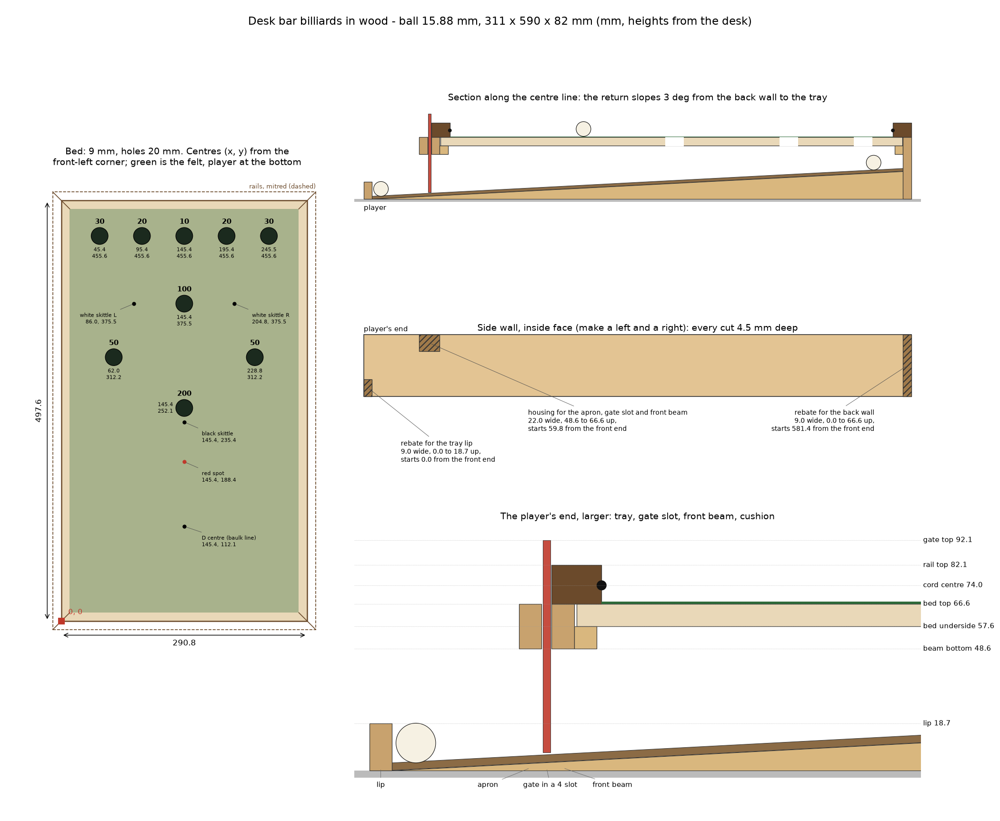

# Desk bar billiards in wood - Large (15.88 mm balls)

Generated by `python woodwork.py` from the same model as the printed table:
the playing area, holes, cushion height, return and gate are identical, so
it plays the same. Only the construction is different. Measurements are
millimetres. Re-run with your own `--size`, `--ball` or `--cord` rather
than scaling these numbers by hand.

## At a glance

| | |
|---|---|
| Ball | 15.88 mm (scale 1:3.00) |
| Playing area | 267 x 474 mm |
| On the desk | 311 x 590 mm, 82 mm to the rail tops |
| Holes | 20 mm (Forstner bit) |
| Bed | 9 mm, 25 mm of room for the balls under it |
| Return | 3 degrees, shared tray at the player's end |

## Buy

| Material | How much |
|---|---|
| 9 mm MDF or birch ply | 0.14 m² of parts (buy a piece with room to spare) |
| 9 mm birch ply | 0.12 m² of parts (buy a piece with room to spare) |
| 3 mm hardboard | 0.16 m² of parts (buy a piece with room to spare) |
| 3 mm ply or acrylic | 0.02 m² of parts (buy a piece with room to spare) |
| softwood strip 9 x 30 mm | 1.72 m |
| softwood strip 9 x 9 mm | 1.55 m |
| hardwood strip 15 x 20 mm | 1.66 m |
| softwood strip 9 x 15 mm | 1.18 m |
| strip ripped from the frame ply 4 x 4 mm | 0.04 m |
| Silicone cord, 4 mm | 1.6 m (cushions) |
| Balls, 15.88 mm | 7 white + 1 red |
| Felt (billiard cloth, or craft felt) | the playing area plus 20 mm all round |
| Wood glue, spray adhesive for the felt, a few panel pins | |

The skittles, the cue tip and butt, and the scoreboard are small enough to
print: `python barbilliards.py --size large` (or the same `--ball`)
writes `skittle.stl`, `cue_*.stl` and `score_*.stl`. To turn the skittles
instead: 26.7 mm tall, a 22.7 mm cap whose rim is 19.7 mm up
(a ball must roll under it), on a 11.3 mm base. Keep them light so
they fall when touched.

## Tools

- A saw that cuts straight (table saw or track saw; a fine handsaw and a guide at this size)
- A 20 mm Forstner bit and a drill stand or a guide block - the holes must be square
- A 4 mm groove: a straight router bit, or saw kerfs, for the cord
- A router with a fence (or a table saw dado set) for the 4.5 mm deep housings,
  and a mitre saw or mitre box for the rail corners
- Clamps, a square, a sharp knife for the felt

## Cut list

Width is the short side of a panel; for strips it is thickness x width.

| Part | Qty | Stock | Thickness | Width | Length | Note |
|---|---|---|---|---|---|---|
| bed | 1 | 9 mm MDF or birch ply | 9.0 | 290.8 | 497.6 | 9 holes, 20 mm; the face that gets the felt up |
| side wall | 2 | 9 mm birch ply | 9.0 | 66.6 | 590.4 | full length, desk to the bed top |
| back wall | 1 | 9 mm birch ply | 9.0 | 66.6 | 301.8 | into the side walls' housings |
| front beam | 1 | 9 mm birch ply | 9.0 | 18.0 | 301.8 | into the side walls' housings; top flush with the bed top, balls pass under it |
| apron | 1 | 9 mm birch ply | 9.0 | 18.0 | 301.8 | into the side walls' housings; 4 mm in front of the front beam: that gap is the gate slot |
| tray lip | 1 | 9 mm birch ply | 9.0 | 18.7 | 301.8 | into the side walls' housings; front of the tray |
| ramp | 1 | 3 mm hardboard | 3.0 | 274.8 | 573.2 | smooth face up; the tray is its front end |
| ramp bearer | 3 | softwood strip | 9.0 | 30.0 | 572.4 | tapered from nothing at the front to 30.0 mm at the back |
| side ledge | 2 | softwood strip | 9.0 | 9.0 | 499.6 | glued inside each side wall, top at the bed's underside |
| end ledge | 2 | softwood strip | 9.0 | 9.0 | 274.8 | on the back wall and the back of the front beam |
| side rail | 2 | hardwood strip | 15.5 | 20.0 | 517.6 | cord groove on the inside face; covers the wall top; mitred 45 deg both ends, long-point length |
| end rail | 2 | hardwood strip | 15.5 | 20.0 | 310.8 | front and back; mitred 45 deg both ends, long-point length |
| foot strip | 2 | softwood strip | 9.0 | 15.0 | 590.4 | outside the foot of each side wall: clamp on these |
| slot filler | 2 | strip ripped from the frame ply | 4.0 | 4.5 | 18.0 | exactly 4 mm thick: sets the gate slot, in the housing between the apron and the front beam |
| time-bar gate | 1 | 3 mm ply or acrylic | 3.0 | 85.0 | 290.8 | drops into the slot; drill a finger hole near the top |

Also in `wood/cut_list.csv`.

## Joints in the side walls

Cut in the **inside** face of both side walls - a left and a right, so
lay them face to face and mark both at once. Every cut is 4.5 mm deep
(half the wall). Measured from the wall's front (player's) end and its
bottom edge:

| Cut | From the front end | Width | From the bottom | To |
|---|---|---|---|---|
| rebate for the tray lip | 0.0 | 9.0 | 0.0 | 18.7 |
| housing for the apron, gate slot and front beam | 59.8 | 22.0 | 48.6 | 66.6 |
| rebate for the back wall | 581.4 | 9.0 | 0.0 | 66.6 |

The rebates run out of the wall's end; the housing runs out of the top
edge and stops at the bottom of the beams, so nothing shows below it.
Square up the stopped end with a chisel, or round the ends of the beam
and apron to match the router bit.

## Marking out the bed

From the bed's **front-left corner** (the player's end, on your left), with
the felt face up. Mark centres with an awl, then drill.

| Mark | Across (X) | Along (Y) |
|---|---|---|
| hole 30 | 45.4 | 455.6 |
| hole 20 | 95.4 | 455.6 |
| hole 10 | 145.4 | 455.6 |
| hole 20 | 195.4 | 455.6 |
| hole 30 | 245.5 | 455.6 |
| hole 100 | 145.4 | 375.5 |
| hole 50 | 62.0 | 312.2 |
| hole 50 | 228.8 | 312.2 |
| hole 200 | 145.4 | 252.1 |
| black skittle | 145.4 | 235.4 |
| white skittle L | 86.0 | 375.5 |
| white skittle R | 204.8 | 375.5 |
| D centre (baulk line) | 145.4 | 112.1 |
| red spot | 145.4 | 188.4 |

Or use the 1:1 template, `previews/felt_template_A4.pdf` (from
`python render.py --size large`): its outline is the cushion line, so
set it 10.0 mm in from each side edge and 10.0 mm in from the
front edge, and prick through the centres.

## Build

1. **Bed.** Drill the nine holes at 20 mm, square to the face, with
   scrap clamped underneath so the exit does not tear out. Ease the top
   edge of each hole with fine paper - a sharp edge throws the ball off.
2. **Rails.** Rip them 20 mm wide and 15.5 mm tall. Cut the cord
   groove in the inside face: 4 mm wide, 2.2 mm deep,
   centred 11.1 mm above the rail's underside. Mitre the four rails to
   length at 45 degrees, groove inside, and dry-fit them as a frame;
   the cord ends meet in the corners.
3. **Frame.** Cut the joints in the side walls (the table above). Rip two
   slot fillers to exactly 4 mm - try the gate between them - and
   glue one into each side wall's housing, centred. Then dry-fit: back wall
   and tray lip in their rebates, apron and front beam in the housing either
   side of the filler. Glue it all up at once and measure the diagonals.
4. **Ramp.** Taper the 3 bearers from nothing at the front to
   30.0 mm at the back - a straight line, which is the 3 degree
   slope. Stand them on the desk inside the frame, one glued against each
   side wall, the rest evenly between, and glue the hardboard on top,
   smooth face up, butting against the back wall.
5. **Ledges.** Glue the side and end ledges so their tops are 57.6 mm
   above the desk - the underside of the bed. Use a block cut to that
   height as a gauge rather than a ruler.
6. **Felt.** Spray-glue the felt to the bed, trimmed to the cushion line
   (10.0 mm in from the sides, 10.0 mm from the front edge): the
   rails sit on the bare wood outside it. Cut out each hole with a sharp
   knife from below, following the wood.
7. **Bed in.** Lay the bed on the ledges and drop a ball through every
   hole: each should roll to the tray on its own, and stop at the gate
   when it is in. Then glue the bed down, weighted flat.
8. **Cushions.** Glue the cord into the grooves with a bead of silicone
   or contact adhesive, stretched only enough to lie straight.
9. **Rails on.** Glue the side rails over the wall tops and the bare edge
   of the bed, then the end rails into the mitres. The cord should just
   touch the edge of the felt.
10. **Gate.** Cut it 291 x 85 mm; it should drop into the
   slot freely and stand clear of the ramp by a millimetre.
11. **Desk.** Glue a foot strip along the outside bottom of each side
   wall and clamp the table down with two small F-clamps on those.

## Checks

- Before the felt: the bed is flat. A straightedge across it in each
  direction shows no light; shim the ledges if not.
- Before gluing the bed (step 7): every hole returns a ball to the tray.
- Last: a ball rolled gently into each cushion comes back off it, and
  one played firmly does not jump the rail.

Rules of play: `README.md` section 7.
